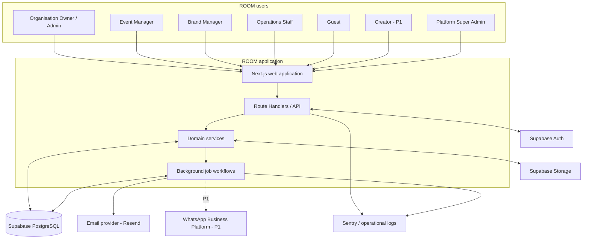
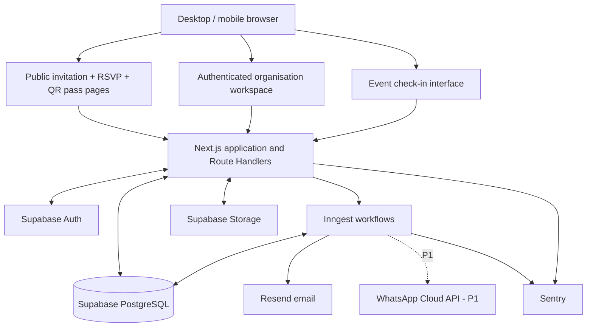
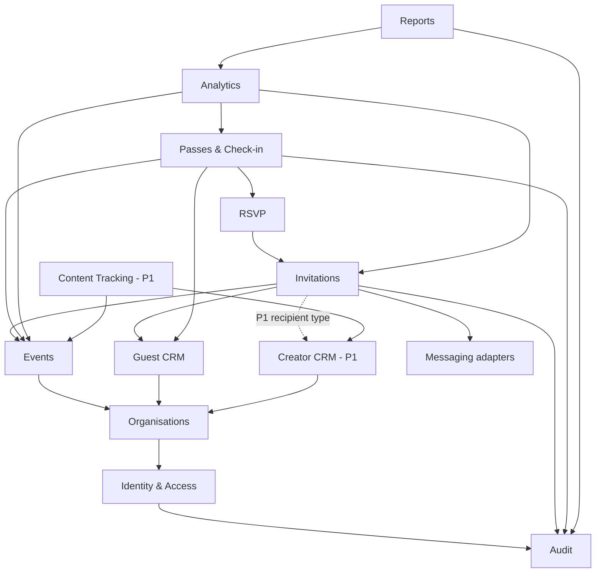
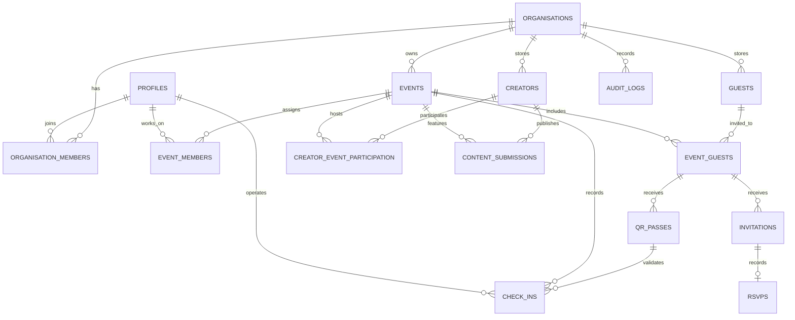
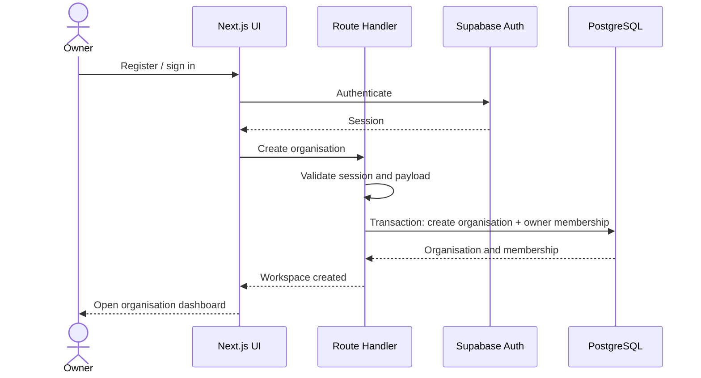
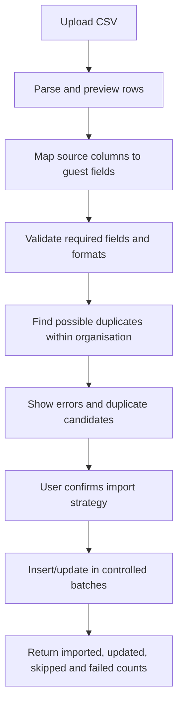
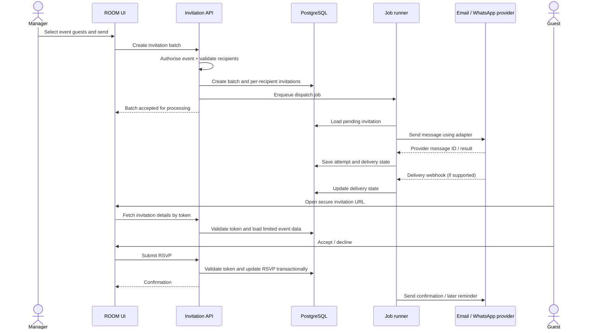
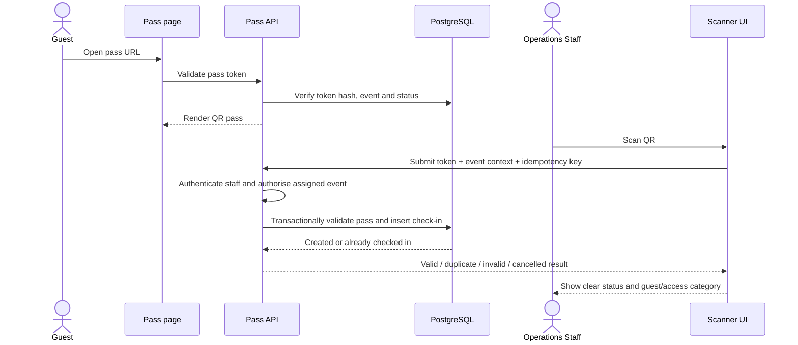
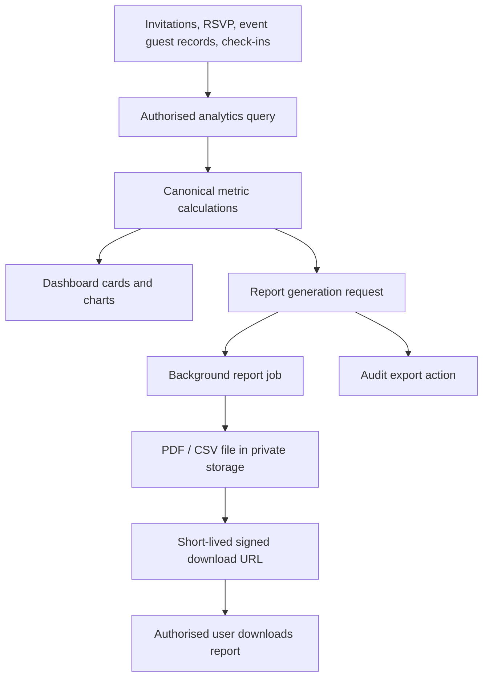
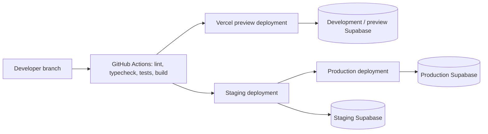

# ROOM — Application Architecture

> **Product:** ROOM  
> **Category:** Event Management + Creator Relationship Management SaaS  
> **Strategy:** B2B-first  
> **Architecture style:** Multi-tenant modular monolith  
> **Status:** Proposed application architecture for the MVP  
> **Source of product requirements:** ROOM PRD  
> **Technology baseline:** `TECH_STACK.md`

---

## 1. Purpose and scope

This document describes how ROOM's application components, domain modules, data, integrations and operational workflows fit together. It translates the product requirements into an implementable architecture; it does not change the PRD's feature priorities.

ROOM is a B2B SaaS workspace for brands and event agencies to manage organisations, events, guest relationships, invitations, attendance and event outcomes. The platform must support multiple organisations with strict data isolation and event-level permissions.

### MVP scope (P0)

- Organisation registration and authentication.
- Organisation membership and role-based access.
- Event creation, editing, assignment and lifecycle management.
- Guest CRM, guest tagging, CSV import and duplicate detection.
- Bulk invitations and RSVP tracking.
- QR pass generation and validation.
- QR check-in, guest search and manual fallback.
- Basic event analytics and PDF/CSV report export.
- Audit logging and tenant isolation.

### Planned after MVP (P1)

- Creator CRM and creator profiles.
- Advanced creator filters and saved lists.
- WhatsApp Business integration.
- Waitlist management.
- Post-event content tracking.
- Advanced analytics and offline-capable check-in.

### Future scope (P2)

AI creator recommendations, automated creator matching, campaign management, permitted social account integrations, relationship intelligence, creator marketplace, public event discovery and enterprise integrations.

The MVP is not a public ticketing marketplace, influencer agency, open social network, unrestricted social scraper or influencer payment-settlement platform.

---

## 2. Architecture decisions

| Decision | Approach | Reason |
|---|---|---|
| Application shape | Modular monolith | One deployable application is faster to build and operate for the initial team and customer base. |
| Tenant model | Shared PostgreSQL database with `organisation_id` scoping and RLS | Supports multiple agencies/brands while enforcing organisation data boundaries. |
| Backend | Next.js Route Handlers plus domain service modules | Keeps API and product logic together without putting business rules in UI components. |
| Data store | Supabase PostgreSQL | ROOM's core data is relational and benefits from constraints, joins and transactions. |
| Identity | Supabase Auth | Managed user identity and session lifecycle. |
| Async work | Inngest (or equivalent managed job runner) | Bulk messages, reminders and report generation must not run in request-response time. |
| Integrations | Provider adapters | Email, WhatsApp and future social integrations can change without rewriting domain logic. |
| Check-in | Server-validated QR token; manual lookup fallback | Prevents client-side trust and duplicate attendance. |
| Realtime | Add only where operationally useful | Avoids unnecessary complexity; attendance dashboard can refresh/poll initially. |
| Offline check-in | P1 capability | PRD requires a fallback; robust offline queue and reconciliation are a planned enhancement. |

**Important:** These are implementation recommendations. They are consistent with the proposed `TECH_STACK.md`, but the PRD itself specifies product behaviour rather than mandating vendors or frameworks.

---

## 3. System context



### External actors and system boundaries

- **Organisation users:** work inside an authenticated organisation workspace.
- **Guests:** use limited, token-protected invitation, RSVP and pass pages; they do not need organisation workspace access.
- **Creators:** become first-class CRM/ecosystem users in P1. Creator profile/contact data must be collected and used only on an authorised basis.
- **External providers:** email, WhatsApp and future social platforms are integration boundaries, not sources of truth for ROOM's event records.

---

## 4. Container and runtime architecture



### Runtime responsibilities

| Component | Responsibilities | Must not do |
|---|---|---|
| Web UI | Render workspace, forms, lists, dashboards, invitation pages and scanner UI | Enforce security only through hidden controls or client-side checks. |
| Route Handlers | Authenticate requests, validate inputs, authorise actions, call domain services and return API responses | Contain large business workflows or send a whole bulk campaign synchronously. |
| Domain services | Own business rules and coordinate database operations | Depend on React components or provider-specific payload formats. |
| PostgreSQL | Source of truth for organisations, events, people, invitations, RSVP and attendance | Rely on client-submitted tenant IDs as proof of access. |
| Background jobs | Dispatch messages, retry transient failures, schedule reminders and generate large reports | Assume a job executes exactly once. Jobs must be idempotent. |
| Storage | Store logos, event imagery, profile images, evidence and report files | Expose private files through unrestricted public URLs. |

---

## 5. Logical domain modules

Each module owns its validation schemas, service functions, repository/data-access functions, types and tests. Modules may call one another through explicit service interfaces.

| Module | Core responsibilities | Priority |
|---|---|---|
| Identity & access | User identity, sessions, organisation membership, roles and event assignments | P0 |
| Organisations | Company profile, logo, settings, subscription reference and workspace setup | P0 |
| Events | Event details, venue, schedule, capacity, visibility, status, team assignment and duplication | P0 |
| Guest CRM | Reusable guest records, tags, notes, contact preferences, import, search, deduplication and history | P0 |
| Invitations | Recipient selection, batches, templates, channel selection and invitation lifecycle | P0 |
| RSVP | Secure guest response, acceptance/decline and response timestamps | P0 |
| Passes & check-in | QR token issue/revoke, validation, attendance recording, manual check-in and duplicate prevention | P0 |
| Analytics | Event-level counts and rates using consistent metric definitions | P0 |
| Reports | Authorised CSV/PDF export and report file lifecycle | P0 |
| Creator CRM | Creator profiles, permitted audience information, saved lists and collaboration history | P1 |
| Content tracking | Post URLs, event/creator association, publication date, manual metrics and evidence | P1 |
| Messaging adapters | Email delivery P0; official WhatsApp delivery P1 | P0/P1 |
| Audit | Security-sensitive actions, exports, role changes and operational overrides | P0 |
| Billing/subscriptions | Subscription lifecycle and plan enforcement | PRD mentions subscription management; detailed billing flows/provider remain to be specified |

### Module dependency direction



Keep dependencies one-directional where possible. Shared primitives (IDs, clock, validation, permission helpers and audit writer) belong in a small platform/core layer rather than becoming a general-purpose dumping ground.

---

## 6. User roles and authorisation model

The PRD defines these roles:

- Platform Super Admin
- Organisation Owner
- Organisation Admin
- Event Manager
- Brand Manager
- Operations Staff
- Creator
- Guest

### Scope model

1. **Platform scope:** Platform Super Admin manages platform-level organisations and subscriptions.
2. **Organisation scope:** Organisation Owner/Admin manage the organisation and its members/settings.
3. **Event scope:** Event Manager and Operations Staff can act only on events to which they are assigned and only for permitted actions.
4. **Brand scope:** Brand Manager access is limited to the organisation's campaigns/creators/reports and the event data explicitly permitted to them.
5. **External token scope:** Guest access is limited to the invitation, RSVP and pass represented by a secure token. Creator access in P1 is limited to their own profile and invitations.

The exact permission matrix should be finalised before production. The following is a proposed baseline, not a verbatim PRD permission table:

| Action | Owner | Org Admin | Event Manager | Brand Manager | Operations Staff | Guest |
|---|---:|---:|---:|---:|---:|---:|
| Manage organisation settings | Yes | Yes | No | No | No | No |
| Manage members and roles | Yes | Yes | No | No | No | No |
| Create/manage events | Yes | Yes | Assigned events | View permitted events | Assigned events: operational fields | No |
| Manage guest lists | Yes | Yes | Assigned events | View permitted records | Assigned event guest lookup | No |
| Send invitations | Yes | Yes | Assigned events | If granted | No | No |
| Check in guests | Yes | Yes | Assigned events | No by default | Assigned events | No |
| View analytics/reports | Yes | Yes | Assigned events | Permitted reports | Operational attendance view | No |
| RSVP | No | No | No | No | No | Own invitation only |

### Enforcement

- Authenticate through Supabase Auth.
- Resolve organisation membership and event assignment on the server for every protected operation.
- Enforce tenant isolation with PostgreSQL Row-Level Security (RLS) as a second line of defence.
- Use server-side permission helpers for action-level rules; RLS alone should not be treated as the complete business permission model.
- Guest and pass tokens are bearer credentials: random, high entropy, scoped, expiring/revocable and rate-limited.
- Never expose Supabase service-role keys in browser bundles.

---

## 7. Core data architecture

PostgreSQL is the source of truth. Use UUID primary keys, foreign keys, timestamps, explicit status fields, indexes and database constraints. Add `organisation_id` to tenant-owned records, even when it can be derived through a parent, where this materially simplifies RLS and query safety; ensure consistency with constraints/triggers or service-level invariants.

### Entity relationship diagram



### Core tables and relationships

| Table | Key fields / purpose | Priority |
|---|---|---|
| `organisations` | `id`, `name`, `type`, `logo_path`, `settings`, `created_at` | P0 |
| `profiles` | `id` (maps to Auth user), display name and basic account profile | P0 |
| `organisation_members` | `organisation_id`, `user_id`, `role`, `status`, inviter and timestamps; unique organisation/user pair | P0 |
| `events` | `id`, `organisation_id`, name, description, category, start/end time, timezone, venue, capacity, visibility, cover path, status | P0 |
| `event_members` | `event_id`, `user_id`, event role/assignment; unique event/user pair | P0 |
| `guests` | `id`, `organisation_id`, name, email, phone, city, organisation/employer, social links, tags, notes, relationship owner, communication preferences | P0 |
| `event_guests` | `event_id`, `guest_id`, category/access level, guest status, plus-one/count fields if supported; unique event/guest pair | P0 |
| `invitation_batches` | Event, creator, template/version, channel, batch status and counts | P0 |
| `invitations` | Event guest, batch, channel, secure token reference, invitation status and timestamps | P0 |
| `invitation_messages` | Invitation, provider, provider message ID, delivery state, error and provider event timestamps | P0 |
| `rsvps` | Invitation, response (`accepted`/`declined` etc.), response time and any permitted response details | P0 |
| `qr_passes` | Event guest, token hash, expiry, revocation state and issue timestamp | P0 |
| `check_ins` | Event, event guest, pass, operator, method, check-in time and idempotency key | P0 |
| `audit_logs` | Organisation, actor, action, resource type/id, metadata and timestamp | P0 |
| `creators` | Creator identity, location, social links, categories, languages, consented contact and authorised audience details | P1 |
| `saved_creator_lists` | Organisation-owned creator collections | P1 |
| `creator_event_participation` | Creator, event, invitation/attendance/collaboration outcome | P1 |
| `content_submissions` | Creator, event, post URL, publication date, hashtag, manually captured metrics and evidence path | P1 |

### Modelling rules

- A guest is a reusable organisation-level contact; `event_guests` represents that person's relationship to one event.
- An invitation is not the same as a message. One invitation may have one or more delivery attempts/messages; retain each provider message ID and delivery outcome.
- Delivery status and RSVP status are separate state machines. `delivered` must never imply `accepted`.
- A guest's access category (e.g. VIP) is event-specific and belongs on the event/guest relationship, not only on the global guest record.
- Do not put personal data into QR payloads. Store only a random opaque token in the QR and only its hash in the database.
- Keep creator audience/engagement data only where verified, available through permitted means and authorised for use.
- Store consent source, scope, timestamp and withdrawal where applicable. Retention and deletion policies must be defined before production.

---

## 8. Key application workflows

### 8.1 Organisation onboarding and workspace access



The initial organisation owner must be created atomically with the organisation. If either insert fails, roll back the operation. A user may belong to more than one organisation; the active workspace is selected in the authenticated UI and verified on every request.

### 8.2 Event creation and assignment

1. Authenticated user opens the organisation workspace.
2. Server verifies organisation membership and event-create permission.
3. User submits event name, description, category, date/time, timezone, venue, capacity, visibility and cover image.
4. Server validates the payload and stores the event as `draft` unless the user explicitly publishes it.
5. User assigns event team members; server verifies each member belongs to the organisation.
6. Event status changes through the allowed lifecycle: `draft`, `published`, `ongoing`, `completed`, `cancelled`.
7. All mutations record actor, organisation, event and timestamp in the audit trail.

### 8.3 Guest import and duplicate handling



- Import is always scoped to the active organisation.
- Do not silently merge ambiguous records. Show duplicate candidates and let the user choose whether to skip, update or create a separate record.
- Use normalised email/phone matching as candidate signals, not as a guarantee that two people are identical.
- Persist an import summary and row-level error report so users can correct failed rows.
- CSV exports must enforce permissions and exclude fields the actor is not allowed to access.

### 8.4 Invitation, delivery and RSVP lifecycle



**Invitation status values from the PRD:** `draft`, `sent`, `delivered` (where supported), `opened` (where supported), `accepted`, `declined`, `waitlisted`, `cancelled`.

Implementation notes:

- Create the invitation record before dispatching the message.
- Enqueue one logical send task per recipient or a bounded chunk of recipients; do not send a large batch inside a web request.
- Use an idempotency key derived from the batch/recipient/channel operation so retries do not create duplicate invitations or duplicate sends.
- Record provider events independently; delivery/open tracking is only available where the provider/channel supports it.
- RSVP links use random, unguessable, revocable tokens. Store token hashes, apply expiry/rate limits and never expose internal database IDs as access credentials.
- Enforce valid state transitions and prevent an old or revoked token from changing an invitation.
- Email is the initial P0 channel in the proposed build order. WhatsApp uses the official Business Platform and is P1; do not use unofficial automation.

### 8.5 QR pass issuance and check-in



Validation must verify:

1. The staff member is authenticated and assigned/authorised for the event.
2. The pass token hash matches an active pass.
3. The pass belongs to the requested event and has not expired or been revoked.
4. The event guest relationship is valid and not cancelled.
5. No successful check-in already exists for the event guest.
6. The check-in insert succeeds within a transaction protected by a unique constraint.

**Duplicate prevention:** enforce a database uniqueness rule for one successful check-in per `(event_id, event_guest_id)` (or equivalent canonical event-guest key). The UI check alone is insufficient. Return a deterministic `already_checked_in` result for repeat scans.

**Manual fallback:** provide guest search by permitted identifiers and a staff-initiated manual check-in action. Record the method and operator. If the network is unavailable in P0, clearly indicate that the system cannot confirm a server-side check-in and provide the event's approved manual contingency procedure; do not falsely show a successful server sync.

**Offline mode (P1):** a PWA may cache a minimal, authorised event guest list in IndexedDB and queue scans locally. On reconnection, sync with idempotency keys and reconcile conflicts server-side. This requires device/session protection, cache expiry and deletion, conflict UX and real-event testing. It is not assumed to exist in the first P0 release.

### 8.6 Analytics and report generation



Use one shared metric definition layer for both dashboard and exports. Proposed definitions:

- **Total invited:** count of unique event guests for whom an invitation has been created/sent, with the exact inclusion rule documented in the UI.
- **Delivery rate:** delivered messages divided by messages with a provider-confirmed delivery outcome; do not treat unknown delivery states as failures.
- **RSVP acceptance rate:** accepted RSVPs divided by invitations with a recorded RSVP response, unless the product explicitly chooses all invitations as denominator. Label the chosen denominator.
- **Decline rate:** declined RSVPs divided by the same clearly labelled RSVP denominator.
- **Actual attendance:** count of unique successful event guest check-ins.
- **No-show rate:** accepted invitees not checked in divided by accepted invitees, after event completion and subject to the final cancellation/late RSVP rules.
- **Creator participation/content metrics:** only when the P1 creator and content data exists; distinguish manually entered/verified metrics from provider-sourced data.

Report generation must check the requester's permissions, create the file asynchronously for larger exports, store it privately and issue a time-limited signed URL. Log exports in the audit trail.

---

## 9. API architecture and endpoint boundaries

Use versionable REST-style endpoints under `/api`. Route handlers should authenticate, validate, authorise and delegate to services. The examples below are a starting contract; request/response schemas should be documented and versioned as implementation proceeds.

| Domain | Example endpoints | Notes |
|---|---|---|
| Organisation | `GET/POST /api/organisations`, `GET/PATCH /api/organisations/:id` | Organisation creation creates owner membership atomically. |
| Members | `GET/POST /api/organisations/:id/members`, `PATCH /api/members/:id/role` | Verify inviter has member-management permission. |
| Events | `GET/POST /api/events`, `GET/PATCH/DELETE /api/events/:id` | Soft-delete/archive policy to be defined; status lifecycle is explicit. |
| Event team | `GET/POST /api/events/:id/members`, `DELETE /api/events/:id/members/:memberId` | Only organisation members can be assigned. |
| Guests | `GET/POST /api/guests`, `GET/PATCH /api/guests/:id` | All list queries paginated and tenant-scoped. |
| Guest import | `POST /api/guests/import`, `GET /api/imports/:id` | Prefer preview/confirm workflow for large or ambiguous imports. |
| Event guest list | `GET/POST /api/events/:id/guests`, `PATCH /api/events/:id/guests/:guestId` | Controls category and event-specific guest status. |
| Invitations | `POST /api/events/:id/invitations`, `GET /api/events/:id/invitations` | Creates batch/recipient rows and queues delivery. |
| RSVP | `GET /api/rsvp/:token`, `POST /api/rsvp/:token` | Token-scoped public endpoint with rate limits. |
| Passes | `GET /api/passes/:token` | Returns only data needed to display a pass. |
| Check-in | `POST /api/events/:id/check-ins`, `GET /api/events/:id/attendance` | Transactional, idempotent and event-authorised. |
| Analytics | `GET /api/events/:id/analytics` | Uses canonical metric service. |
| Reports | `POST /api/events/:id/reports`, `GET /api/reports/:id` | Async generation and permission-checked download. |
| Creators (P1) | `GET/POST /api/creators`, `GET/PATCH /api/creators/:id` | Organisation-scoped creator records. |
| Content (P1) | `POST /api/events/:id/content`, `GET /api/events/:id/content` | Manual evidence and permitted metrics. |

### API conventions

- Validate all incoming data with Zod on the server.
- Derive actor identity from the authenticated session.
- Never trust a client-provided `organisation_id`, `user_id` or role without resolving it server-side.
- Use cursor or page-based pagination consistently for list endpoints.
- Return stable machine-readable error codes for invalid, unauthorised, duplicate and conflict states.
- Use idempotency keys for send, import, RSVP and check-in operations where retries can occur.
- Rate-limit public token endpoints and sensitive operations.
- Avoid returning internal notes or private contact data to guest/public endpoints.

---

## 10. Background jobs and reliability

Use Inngest or an equivalent managed job runner for:

- Bulk invitation dispatch.
- Scheduled reminders.
- Provider webhook processing and delivery updates.
- Retryable message sends.
- Large CSV/PDF exports.
- P1 post-event processing where required.

### Job design rules

1. Persist the intended operation in PostgreSQL before enqueueing or dispatching it.
2. Give every logical task a stable idempotency key.
3. Retry only transient failures, with exponential backoff and a maximum attempt policy.
4. Treat provider timeouts as unknown outcomes until reconciled; avoid blind duplicate sends.
5. Persist attempt count, last error, next retry and terminal state.
6. Provide a dead-letter/manual-retry path for failed batches.
7. Make jobs observable through structured logs and error monitoring.

### Messaging adapter contract

The domain layer should call a provider-neutral interface, for example:

```ts
interface MessagingProvider {
  sendInvitation(input: InvitationMessageInput): Promise<SendResult>;
  sendReminder(input: ReminderMessageInput): Promise<SendResult>;
  getDeliveryStatus?(providerMessageId: string): Promise<DeliveryStatus>;
}
```

Implement email first. Add the official WhatsApp Business Platform adapter in P1, including template approval, opt-in, messaging-window and provider policy handling. Keep provider-specific message formats inside each adapter.

---

## 11. Frontend application structure

Suggested route structure:

```text
src/app/
├── (auth)/
│   ├── sign-in/
│   ├── sign-up/
│   └── accept-organisation-invite/
├── (workspace)/
│   └── [organisationSlug]/
│       ├── dashboard/
│       ├── events/
│       │   ├── new/
│       │   └── [eventId]/
│       ├── guests/
│       ├── invitations/
│       ├── check-in/[eventId]/
│       ├── analytics/[eventId]/
│       ├── reports/
│       └── settings/
├── invite/[token]/
├── rsvp/[token]/
├── pass/[token]/
└── api/
```

Suggested feature/module structure:

```text
src/
├── app/                       # Next.js routes and route handlers
├── components/                # Shared UI primitives
├── features/
│   ├── organisations/
│   ├── members/
│   ├── events/
│   ├── guests/
│   ├── invitations/
│   ├── rsvp/
│   ├── passes/
│   ├── check-in/
│   ├── analytics/
│   ├── reports/
│   ├── creators/              # P1
│   └── content/               # P1
├── server/
│   ├── auth/
│   ├── permissions/
│   ├── services/
│   ├── repositories/
│   ├── integrations/
│   └── jobs/
├── lib/                       # Supabase clients, validation, utilities
└── types/
```

Keep server-only code in server modules and mark secrets/provider clients as server-only. Browser components should call typed API functions rather than querying privileged tables directly.

---

## 12. Security, privacy and audit architecture

### Tenant isolation

- Enable RLS on every organisation-owned table.
- Scope all queries by active organisation and verify membership.
- Where records are event-scoped, verify event membership/assignment and role.
- Add indexes for `organisation_id`, `event_id`, foreign keys and common search fields.
- Add automated tests proving Organisation A cannot read or mutate Organisation B data.

### Public access and tokens

- Invitation and pass tokens must be cryptographically random, high entropy and scoped to one resource/action.
- Store only token hashes; compare securely on the server.
- Support expiry and revocation.
- Rate-limit token lookup and RSVP attempts; avoid revealing whether arbitrary emails/phone numbers exist.
- Public endpoints return only event details needed by the invitee.

### Personal data

- Collect only information needed for event operations and creator relationship management.
- Capture communication preferences and consent records where required.
- Provide processes for correction, export, deletion and retention expiry.
- Restrict internal notes and personal contact fields by role.
- Obtain legal review for applicable Indian data protection obligations and vendor contracts; technical controls do not alone establish legal compliance.

### Audit events

At minimum, audit:

- Organisation creation and settings changes.
- Member invitations, removals and role changes.
- Event creation, publication, cancellation and assignment changes.
- Guest imports and exports.
- Invitation batch creation and cancellation.
- Manual check-in, check-in override and pass revocation.
- Report generation and downloads.
- Sensitive data access or administrative actions where appropriate.

Audit records should be append-only for normal application roles. Avoid storing unnecessary personal data in audit metadata.

---

## 13. Performance, availability and observability

The PRD's initial targets are:

| Metric | Target |
|---|---:|
| Dashboard load | Under 3 seconds under normal conditions |
| Guest search | Under 1 second for typical datasets |
| QR validation | Under 2 seconds under normal connectivity |
| Check-in | Idempotent; duplicate entries blocked |

Implementation considerations:

- Paginate guest and invitation lists; do not load an entire organisation's CRM into the browser.
- Index organisation/event foreign keys, normalized email/phone search keys and common filter columns.
- Use server-side filtering and sorting for large lists.
- Keep check-in API responses small and avoid nonessential external provider calls in the scan path.
- Use database transactions and constraints for RSVP/check-in state changes.
- Cache only non-sensitive, stable data; tenant-specific cache keys must include organisation scope.
- Monitor API latency, database errors, job queue lag, invitation failures, webhook processing, report generation and check-in outcomes.
- Use Sentry for application exceptions and structured logs with request/job correlation IDs.
- Back up production data and periodically test restoration.

---

## 14. Environments and deployment topology



Maintain isolated development, staging and production environments. Each environment must have separate Supabase projects/credentials, storage buckets, job environment and provider credentials. Preview deployments must never connect to production data by default.

- Version database migrations and apply them through a controlled release process.
- Store secrets in deployment secret management, never in Git.
- Run lint, type-check, unit, integration and end-to-end tests in CI.
- Require review for schema/RLS changes.
- Test backups and restoration before the first production pilot.
- Monitor production after each release, especially before and during live events.

---

## 15. Failure handling and operational fallbacks

| Failure | Expected behaviour |
|---|---|
| Email provider unavailable | Persist invitation; retry transient failures; show pending/failed status accurately. |
| WhatsApp provider unavailable (P1) | Retry according to provider policy; allow configured fallback channel where consent and product rules permit. |
| Provider webhook delayed | Keep delivery state as pending/unknown until confirmed; reconcile later. |
| Duplicate job execution | Idempotency prevents duplicate logical invitations or state changes. |
| QR camera permission denied | Offer manual guest search and check-in. |
| Invalid/revoked QR | Reject with a clear status; do not create attendance. |
| Guest already checked in | Return `already_checked_in`; show existing check-in time/operator if permitted. |
| Network failure during check-in | Do not claim server success. Use the approved manual contingency in P0; use queued offline sync only after P1 is implemented and tested. |
| Report generation failure | Preserve request state, surface failure and allow safe retry. |
| CSV rows invalid | Return row-level errors and a summary; do not silently discard data. |

---

## 16. Testing strategy

| Test type | Focus |
|---|---|
| Unit (Vitest) | Domain rules, validation, status transitions, metrics and token helpers |
| Component (React Testing Library) | Forms, tables, dialogs, RSVP states and scanner feedback |
| API integration | Authentication, authorisation, validation, idempotency and error responses |
| Database/RLS | Tenant isolation, role access, foreign keys, unique constraints and transaction safety |
| End-to-end (Playwright) | Onboarding, event creation, guest import, invitation, RSVP, pass and check-in journeys |
| Operational tests | Provider webhook retries, queue failures, backup restoration and event-day check-in load |

### Required release-gate tests

- Organisation A cannot read/update/delete Organisation B records.
- An event manager cannot access an unassigned event.
- Operations Staff cannot change organisation roles/settings.
- A guest token cannot access another guest's invitation or pass.
- RSVP token expiry/revocation is enforced.
- Retried invitation jobs do not create duplicate invitation records or unintended duplicate sends.
- A guest can only have one successful check-in per event.
- Simultaneous scans of the same pass produce one successful check-in.
- Cancelled/expired/revoked passes are rejected.
- CSV import duplicate handling and row-level errors work as expected.
- Report exports enforce permissions and use private, expiring download links.

---

## 17. Suggested implementation sequence

### Phase 0 — Foundations

1. Create Next.js + TypeScript application and shared UI foundation.
2. Configure Supabase environments, migrations and typed database access.
3. Implement Auth, organisation creation and owner membership.
4. Implement RLS policies, permission helpers and tenant-isolation tests before feature expansion.
5. Add audit logging and CI/CD baseline.

### Phase 1 — P0 event operations

1. Organisation workspace, member invitations and roles.
2. Event CRUD, event lifecycle and event team assignment.
3. Guest CRM, tags, search, CSV import, duplicate review and export.
4. Invitation records, email adapter, background dispatch and guest invitation page.
5. RSVP response flow and confirmation.
6. Secure QR pass issuance and pass page.
7. Check-in scanner, guest search, transactional duplicate prevention and manual fallback.
8. Canonical event metrics and PDF/CSV reports.
9. Security, performance, backup and event-day reliability testing.

### Phase 2 — P1 ecosystem and operations improvements

1. Creator CRM and creator profiles.
2. Advanced creator filters and saved creator lists.
3. Official WhatsApp Business integration.
4. Waitlist and reminder enhancements.
5. Post-event content tracking and evidence uploads.
6. Offline-capable PWA check-in and sync/conflict handling.
7. Advanced analytics.

### Phase 3 — P2 intelligence and expansion

Introduce AI recommendations, creator matching, campaign management, authorised social account integrations, relationship intelligence, marketplace/discovery capabilities and enterprise integrations only after the core workflows and data quality are proven.

---

## 18. Open decisions before production

The PRD and current technical stack do not fully specify the following. Confirm them during product/engineering discovery rather than silently assuming them:

1. **Organisation structure:** can a brand be a client under an agency workspace, or must each brand be a separate tenant? This affects cross-organisation client reporting and data ownership.
2. **Guest identity and deduplication:** what is the canonical matching policy when email/phone is missing, shared or changed?
3. **Plus-ones and group invitations:** does one invitation cover one person or a household/group, and how is capacity counted?
4. **Waitlist rules:** when does a waitlisted guest become accepted, and who can promote them? (P1.)
5. **Public event visibility:** what does “public” mean in the absence of a public event discovery marketplace, which is a P2 non-goal?
6. **Subscription/billing:** plans are listed in the PRD, but billing provider, entitlements, invoices, trials and usage limits are not defined.
7. **WhatsApp launch readiness:** opt-in capture, approved templates, fallback behaviour, sender ownership and message-cost allocation need operational decisions. (P1.)
8. **Creator data provenance:** which profile/audience fields are manually supplied, creator-authorised or sourced through approved APIs?
9. **Offline check-in policy:** whether the first pilot requires true offline scanning or accepts a manual contingency; the PRD calls for a manual fallback and identifies poor connectivity as a risk.
10. **Data retention and deletion:** define retention periods for guest records, event data, message logs, QR tokens, audit records and uploaded evidence.
11. **Reporting definitions:** approve denominators and inclusion rules for delivery, RSVP, no-show and creator impact metrics.
12. **Data region and vendor terms:** validate customer requirements, vendor processing terms, latency and applicable legal obligations before production.

---

## 19. Architecture guardrails

- Do not split the MVP into microservices or introduce Kubernetes without a demonstrated need.
- Do not let UI components access privileged database operations directly.
- Do not rely on client-side role checks for security.
- Do not send bulk messages synchronously from an HTTP request.
- Do not use personal details inside QR codes.
- Do not mark a guest checked in until the server confirms the transaction (unless a later, explicit offline workflow records a clearly pending local check-in).
- Do not treat message delivery as RSVP acceptance.
- Do not scrape Instagram or collect social metrics without an authorised, permitted method.
- Keep creator intelligence, marketplace features and AI outside the P0 critical path.

---

## 20. Final architecture recommendation

Build ROOM as a **Next.js + TypeScript modular monolith**, backed by **Supabase PostgreSQL, Supabase Auth and Supabase Storage**, with **RLS plus server-side role checks**, **Inngest-managed background jobs**, **Resend email**, and **server-validated QR passes/check-in**. Add official WhatsApp Business integration, creator CRM, content tracking and robust offline check-in in P1 according to the PRD priorities.

The most important architectural investments are not sophisticated infrastructure. They are: correct organisation/event boundaries, a reusable guest relationship model, reliable invitation and RSVP state transitions, transaction-safe check-in, and consistent event reporting. These are the foundations that make ROOM trustworthy for real event operations.
